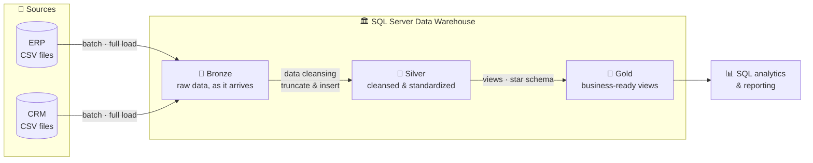
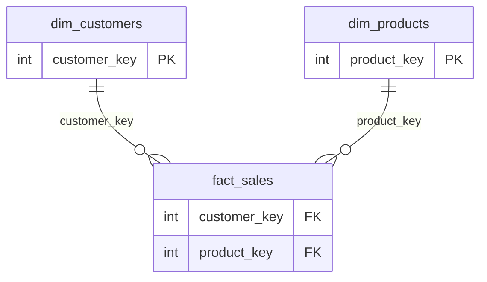

<div align="center">

# 🏛️ SQL Data Warehouse Project

### From messy CSV files to boardroom-ready insights

*A modern, medallion-style data warehouse built on SQL Server, with ETL pipelines, a star schema and SQL analytics on top.*


</div>

---

## 📑 Table of Contents

1. [Project Overview](#-project-overview)
2. [Architecture](#-architecture)
3. [How the Data Moves (ETL)](#-how-the-data-moves-etl)
4. [Data Model](#-data-model)
5. [Project Requirements](#-project-requirements)
6. [Tools & Links](#-tools--links)
7. [Repository Structure](#-repository-structure)
8. [Credits](#-credits)
9. [License](#-license)
10. [About Me](#-about-me)

---

## 📖 Project Overview

Raw data is a bit like ore: valuable, but nobody can use it straight out of the ground. This project takes sales data from two source systems and refines it, layer by layer, until it is ready for the people who make decisions.

In this project, I:

1. **Designed the architecture:** a modern data warehouse with three layers: Bronze, Silver and Gold.
2. **Built the ETL pipelines:** loaded the source files and moved the data through each layer.
3. **Modeled the data:** facts and dimensions in a star schema, ready for reporting.
4. **Analyzed it:** answered real business questions with SQL.

---

## 🏗️ Architecture

The warehouse follows the **medallion architecture**. Each layer has one job, and data only moves forward.



### The three layers at a glance

| | Layer | Its job | Object type | Loading | What happens to the data |
|---|-------|---------|-------------|---------|--------------------------|
| 🥉 | **Bronze** | Receives the data exactly as it comes in the CSV files | Tables | Batch processing, full load, truncate & insert | Nothing. It stays raw. |
| 🥈 | **Silver** | Turns raw data into trustworthy data | Tables | Batch processing, full load, truncate & insert | Data cleansing |
| 🥇 | **Gold** | Serves data that is ready for the business | Views | None, since views always read from Silver | Modeled as a star schema |

---

## 🔄 How the Data Moves (ETL)

Bronze and Silver are loaded in **batches** with a **full load** strategy, using **truncate & insert**:

1. **Truncate:** the target table is emptied.
2. **Insert:** the full dataset is loaded again from scratch.

Simple, predictable and easy to re-run. It also fits the project scope perfectly, since only the latest dataset matters and there is no need to keep history.

Each load lives in its own stored procedure, named after the layer it feeds:

```sql
EXEC bronze.load_bronze;   -- CSV files  ➜  Bronze
EXEC silver.load_silver;   -- Bronze     ➜  Silver (cleansed)
```

Gold has no load step. It is a set of **views** on top of Silver, so it always reflects the latest clean data.

---

## ⭐ Data Model

The Gold layer is modeled as a **star schema**: one fact table in the center, surrounded by the dimensions that give it context.



> [!NOTE]
> The diagram shows the keys that connect the model. The full data model, with every column, is documented in the `docs` folder.

All objects follow a consistent set of rules, described in the [Naming Conventions](docs/naming_conventions.md).

---

## 🚀 Project Requirements

### 🧱 Building the Data Warehouse (Data Engineering)

**Objective:** develop a modern data warehouse using SQL Server to consolidate sales data, enabling analytical reporting and informed decision-making.

| Requirement | Details |
|-------------|---------|
| 📥 **Data sources** | Import data from two source systems (ERP and CRM), provided as CSV files. |
| 🧼 **Data quality** | Cleanse and resolve data quality issues before any analysis. |
| 🔗 **Integration** | Combine both sources into a single, user-friendly data model designed for analytical queries. |
| 🎯 **Scope** | Focus on the latest dataset only. Historization of data is not required. |
| 📚 **Documentation** | Provide clear documentation of the data model, for both business stakeholders and analytics teams. |

### 📊 BI: Analytics & Reporting (Data Analysis)

**Objective:** develop SQL-based analytics that deliver detailed insights into:

- 👥 **Customer behavior**
- 📦 **Product performance**
- 📈 **Sales trends**

These insights give stakeholders the key business metrics they need to make strategic decisions.

---

## 🛠️ Tools & Links

| Tool | What I used it for |
|------|--------------------|
| **SQL Server & SSMS** | The database and the client to work with it. The setup guide in `00_setup` has the links and every step. |
| [**Git / GitHub**](https://github.com/) | Saving and sharing the project. |
| [**draw.io**](https://www.drawio.com/) | Drawing the architecture and the data model. |
| [**Notion template**](https://www.notion.com/templates/sql-data-warehouse-project) | The project plan, ready to copy. |
| [**Notion project steps**](https://thankful-pangolin-2ca.notion.site/SQL-Data-Warehouse-Project-16ed041640ef80489667cfe2f380b269?pvs=4) | Every phase and task of the project. |

---

## 📂 Repository Structure

```text
sql-data-warehouse-project/
│
├── 00_setup/          # Setup guide: SQL Server, SSMS and first steps
├── datasets/          # Source files from the ERP and CRM systems (CSV)
├── docs/              # Architecture, data model and naming conventions
├── scripts/
│   ├── bronze/        # Raw layer: tables and load procedure
│   ├── silver/        # Cleansed layer: tables and load procedure
│   └── gold/          # Business layer: star schema views
├── tests/             # Data quality checks
├── LICENSE
└── README.md
```

---

## 🙏 Credits

This project was built following the [SQL Data Warehouse Project](https://github.com/DataWithBaraa/sql-data-warehouse-project) by DataWithBaraa, which is shared under the MIT License. Thanks for making it available to learn from.

---

## 🛡️ License

This project is licensed under the [MIT License](LICENSE). Use it, change it, share it, with attribution.

---

## 🌟 About Me

Hi, I'm **Joelson Baptista**. 👋

I am an aspiring data analyst, and I build projects to showcase my data analytics skills using **SQL**, **Python**, **Power BI** and **Excel**.
